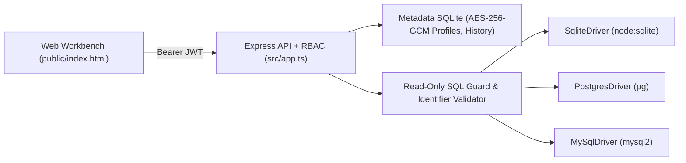

# QueryPilot

Multi-engine SQL workbench and database management platform supporting SQLite, PostgreSQL, and MySQL with encrypted connection profiles, read-only query enforcement, ER visualization, backup/restore, and migrations.

## Overview & Problem Statement

Engineering teams often switch between engine-specific desktop clients for SQLite, PostgreSQL, and MySQL, leaving connection strings unencrypted on disk or lacking shared read-only guardrails. QueryPilot unifies database exploration, query execution, execution plans, exports, backups, and migrations behind an authenticated REST API and web workbench.

## Features

- **Multi-Engine Driver Architecture**: Native SQLite (`node:sqlite`), PostgreSQL (`pg`), and MySQL (`mysql2`) drivers behind a unified `DatabaseDriver` contract.
- **Schema & Relationship Explorer**: Inspect schemas, tables, views, columns, primary keys, indexes, and render SVG foreign-key ER relationship diagrams.
- **SQL Workbench**: Execute queries with millisecond execution timing, `EXPLAIN` / `EXPLAIN QUERY PLAN` output, keyword + table autocomplete hints, saved queries, and persistent execution history.
- **Data Viewer & Safe Exports**: Browse paginated table rows, export formula-neutralized CSV files, or generate SQL (`DDL + INSERT`) dumps.
- **Backup, Restore & Migrations**: Create and restore SQL backups (`backups/*.sql`) and apply transactional versioned migrations (`qp_migrations`).
- **Security Controls**: AES-256-GCM encrypted connection profiles at rest, `scrypt` password hashing, RBAC (`admin`, `editor`, `viewer`), strict SQL identifier validation, and read-only SQL keyword guardrails.

## Technology Stack

- **Backend**: Node.js 22.5+, TypeScript 5.7, Express 4, Helmet, `jsonwebtoken`
- **Database Drivers**: Built-in `node:sqlite`, `pg`, `mysql2`
- **Frontend**: Vanilla HTML/CSS/JS workbench + SVG ER renderer

## Quick Start

1. **Requirements**: Node.js 22.5+
2. **Clone**: `git clone https://github.com/fully-ai/querypilot.git && cd querypilot`
3. **Install & Build**: `./scripts/install.sh` (Windows: `.\scripts\install.ps1`)
4. **Configure**: Copy `.env.example` to `.env` and set `QUERYPILOT_JWT_SECRET` & `QUERYPILOT_MASTER_KEY`
5. **Start**: `./scripts/dev.sh` (Windows: `.\scripts\dev.ps1`)
6. **Open**: `http://127.0.0.1:8092`
7. **Run Tests**: `./scripts/test.sh` (Windows: `.\scripts\test.ps1`)
8. **Stop**: `Ctrl+C` (or `docker compose down`)

## Configuration & Environment Variables

| Variable | Default | Description |
| --- | --- | --- |
| `QUERYPILOT_HOST` | `127.0.0.1` | HTTP bind host |
| `QUERYPILOT_PORT` | `8092` | HTTP port |
| `QUERYPILOT_DATA_DIR` | `./data` | Directory holding `querypilot_meta.db` and `backups/` |
| `QUERYPILOT_JWT_SECRET` | random per boot | JWT HMAC signing key |
| `QUERYPILOT_MASTER_KEY` | random per boot | Passphrase hashed via SHA-256 for AES-256-GCM connection encryption |

## API Summary

| Endpoint | Min Role | Description |
| --- | --- | --- |
| `POST /api/auth/register` / `login` | Public | Register user or sign in for JWT |
| `GET/POST/DELETE /api/connections` | `viewer` / `admin` | List, add encrypted profile, or remove connection |
| `GET /api/connections/{id}/tables` | `viewer` | List tables & views |
| `GET /api/connections/{id}/tables/{table}` | `viewer` | Columns, indexes, foreign keys |
| `GET /api/connections/{id}/relationships` | `viewer` | Foreign-key ER graph edges |
| `POST /api/connections/{id}/query` | `viewer` | Execute SQL or `EXPLAIN` (`read_only` enforced for `viewer` & RO profiles) |
| `POST /api/connections/{id}/export` | `viewer` | Export CSV or SQL dump |
| `POST /api/connections/{id}/backup` / `restore` | `editor` / `admin` | Create or restore SQL backup |
| `GET/POST /api/connections/{id}/migrations` | `viewer` / `editor` | Inspect or apply transactional migrations |
| `GET/POST/DELETE /api/saved-queries`, `GET /api/history` | `viewer` / `editor` | Manage saved queries and audit execution history |

## Architecture



## Docker Deployment

```bash
QUERYPILOT_JWT_SECRET="secret" QUERYPILOT_MASTER_KEY="master" docker compose up --build -d
docker compose logs -f
docker compose down
```

## Testing, Security & Known Limitations

- Automated integration tests run against live SQLite databases via `node --test`. PostgreSQL and MySQL drivers are compiled and type-checked cleanly (`tsc --noEmit`), while live PostgreSQL/MySQL query execution requires running external database instances.
- Always set a persistent `QUERYPILOT_MASTER_KEY` in production; changing it invalidates previously encrypted connection URIs.

## Contributing & License

See [CONTRIBUTING.md](CONTRIBUTING.md), [SECURITY.md](SECURITY.md), and [LICENSE](LICENSE) (Apache 2.0).
